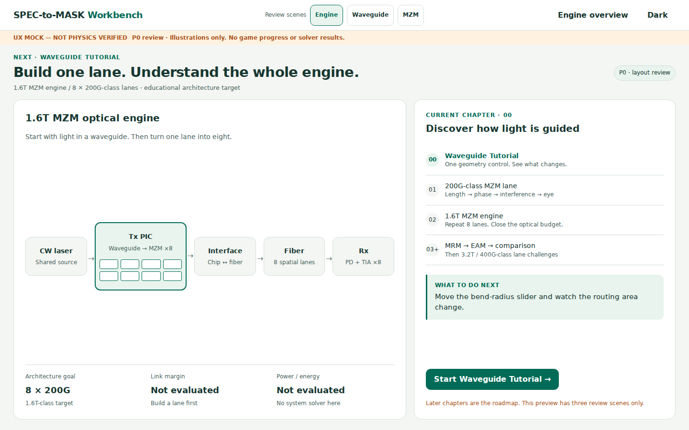
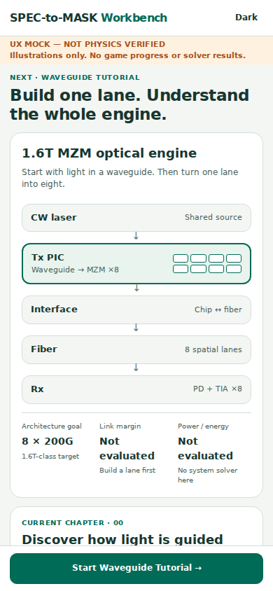
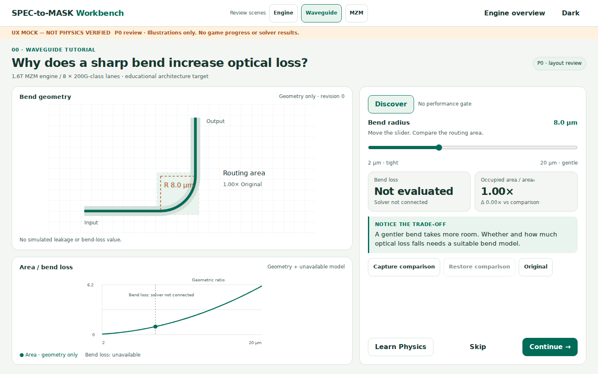
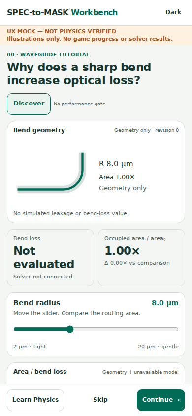
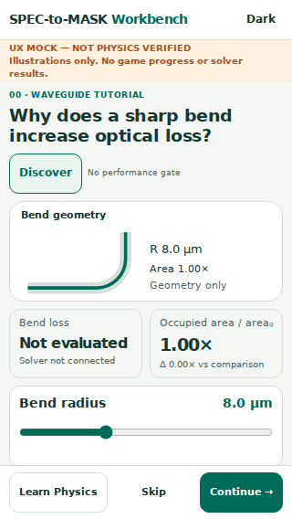
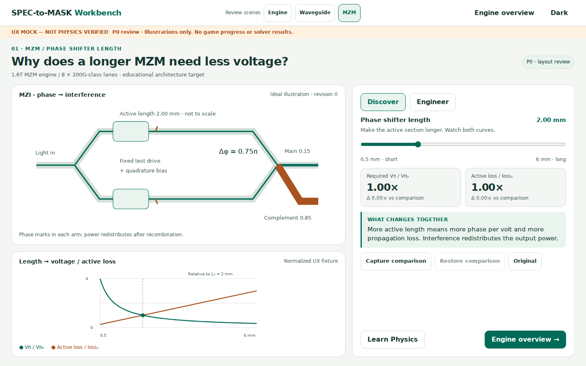
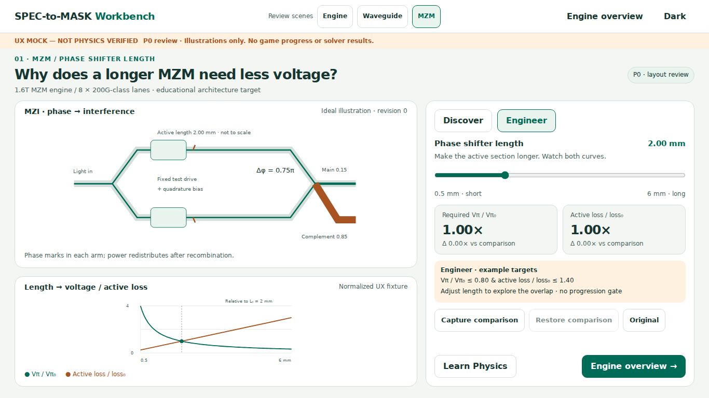
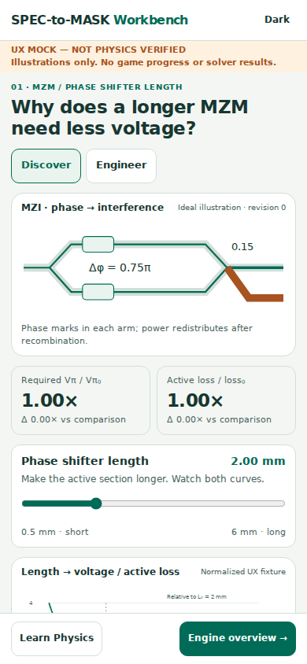
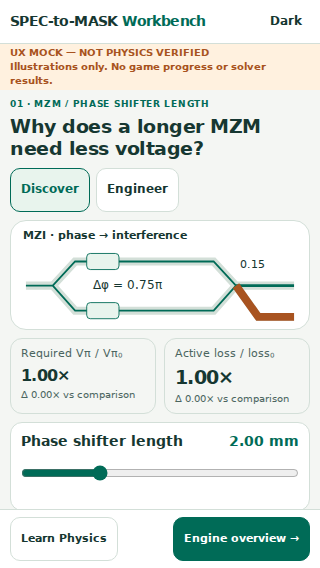
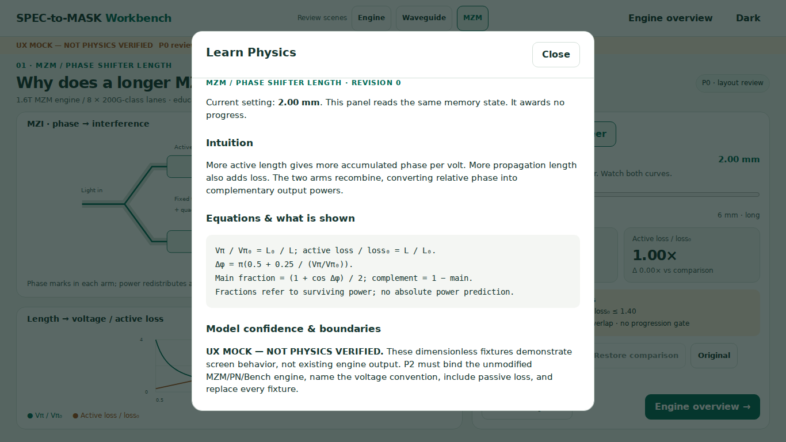

# v2 P0 — Three Concrete Screen Wireframes

2026-10-18 KST · **UX MOCK — NOT PHYSICS VERIFIED**.
[Open standalone HTML](../prototypes/v2-p0/index.html) (download/open locally; GitHub's code viewer does not execute HTML). [Prototype instructions](../prototypes/v2-p0/README.md). [Measured bounds](../prototypes/v2-p0/verification.json). Prototype is isolated and memory-only.

## Shared screen shell

Desktop shell: x0/y0/w1440/h64; mock banner y64/h30. Content x28 to1412, top y112; question and compact engine context; Workbench top y208 to878. Physical/plot left w821; 16px gutter; right panel x865/w547. Effective split 60:40. P0 review scene navigation is in the top shell; **remove it in the game**. Learn Physics is optional and visible near the primary action. No Tune/Inspect tab separation.

Desktop action areas and KPI values are DOM elements, not baked into an image. SVG diagrams are hand-authored schematic views. Images below are **actual Chromium screenshots** of the HTML, not generated concept art.

Mobile shell: 52px at390 width / 44px at320; visible mock banner wraps. Workbench uses flex order: modes → physical view → live KPI → knob → graph → discovery → comparison. Bottom action bar is fixed, with matching content bottom padding. On small phones graph and explanatory content scroll intentionally, while live KPI + knob are in the first viewport. No nested Tune/Inspect navigation.

## Scene 1 — 1.6T Engine Overview

**Question / intent:** What am I building, and what should I do next?
**Primary action:** Start Waveguide Tutorial. One action, bottom-fixed on mobile.
**Current part:** Waveguide in Tx PIC; eight outlined lanes show the intended repetition, not eight completed lanes.

### Desktop, 1440×900

| Component | Placement / allocation | Content / interaction |
|---|---|---|
| Heading | x28 y112, full-width question row | Next: Waveguide Tutorial; overall 1.6T goal |
| Engine map | Grid left `3fr`, x28 y208 w821 h670; 24px inner padding | Five nodes, Laser → Tx PIC → Interface → Fiber → Rx. Tx highlighted; eight planned lane cells |
| Aggregate strip | Bottom of engine card, three equal columns | 8×200G architecture target; margin and power “Not evaluated” |
| Current chapter | Right `2fr`, x865 y208 w547 h670; 24px padding | Tutorial → lane → first complete MZM engine → MRM/EAM/comparison/challenge roadmap |
| Start | Right panel lower area; observed x890 y772 w497 h44 | Opens Scene 2 without changing any production data |

### Mobile, 390×844 / 320×568

Map and chapter card stack. Five short vertical nodes retain labels and eight-lane Tx context; none require a tiny horizontal panorama. Start action is fixed at y779/h65 on390 and y503/h65 on320. Eyebrow states the next Tutorial even when the chapter card is below the fold. Aggregate values may wrap; uncomputed values remain explicit. No settings menu is required before starting.

**Future production behavior:** accumulated engineering KPIs show current results only when all dependencies are evaluated for the current engine identity; separate historical completion from current validity. Opening a component returns to its saved lesson/design. Later stages are not clickable fake completed products in P0.

## Scene 2 — Waveguide Tutorial

**Exact learning question:** “Why does a sharp waveguide bend increase optical loss?”
**Main manipulation:** Bend Radius, 2–20µm, 0.5µm steps (UX geometry fixture only).
**Core observations:** changed bend geometry; bend-only occupied-area ratio; bend loss **Not evaluated**.
**Action:** Continue or Skip, no Laser/PAM4/Fab/Verify gate.

### Desktop wireframe / response map

| Component | x / y / width / height at1440×900 | Response |
|---|---|---|
| Physical view | 28 / 208 / 821 / 394 | R changes path curvature and geometry box; no computed radiation halo |
| Live graph | 28 / 618 / 821 / 260 | Area ratio vs R and current marker; explicit unavailable optical-loss model |
| Control panel | 865 / 208 / 547 / 670 | One labeled Bend Radius input; Discover shown; no target optimization |
| Primary slider | 886 / 333 / 505 / 44 | Input event updates the same fixture revision |
| KPI pair | 886 / 413 / 505 / 96 | Loss unavailable; occupied-area ratio vs protected Original / captured comparison |
| Discovery / comparison | Below KPI, above actions | One short trade-off; Capture / Restore comparison and Original |
| Action row | 886 / 813 / 505 / 44 | Learn Physics, Skip, Continue |

At1366×768 compact CSS preserves the same layout; exact DOM bounds are in verification.json. The baseline diagram and chart are not borrowed from unrelated laser or eye conditions.

### Mobile wireframe

| Element | 390×844 (x,y,w,h px; rounded) | 320×568 |
|---|---|---|
| Physical geometry | 14,245,362,208 | 10,220,300,110 |
| Live KPI | 14,465,362,116 | 10,338,300,76 |
| Slider | 27,646,336,44 | 21,451,278,44 input, within labeled control card |
| Plot | 14,735,362,210, scroll intentionally | 10,519,300,210, scroll intentionally |
| Fixed actions | 0,779,390,65 | 0,509,320,59 |

Small screens use a simpler SVG schematic with readable R/area labels rather than shrinking the desktop diagram. The compact320px slider and buttons, including mode chips, are44px high; min/max endpoint text is hidden at the smallest height to keep the whole control reachable.

### Physics boundary and P1 choice

The existing `KINDS.wg` exposes **width**, mode index/count and a scattering surrogate; it has no bend-loss evaluator. The P0 ratio `(R+w/2)^2 / (R₀+w/2)^2` uses fixed w=0.45µm and R₀=8µm, for the isolated quarter bend's outer occupied square, excluding leads/clearance. It is geometry, not an optical measurement or area estimate for a whole routing channel.

Recommended P1 uses the existing `LAB.routeLoss` path for a single strip-waveguide 90° arc, after checking domain and units; its bend and propagation terms remain separate. Width with a **new explicit width/mode question** is the fallback. No new coefficients are needed for this existing kernel. Do not claim the exact bend question is quantitatively solved by width/scattering. [Source audit and extension boundaries](V2_REUSE_MAP.md#3-existing-equations-and-numerical-audit).

## Scene 3 — MZM Physics Workbench

**Exact learning question:** “Why does a longer MZM require less drive voltage?”
**Main manipulation:** Phase Shifter Length, 0.5–6mm, 0.05mm step.
**Observe:** phase accumulation in two paths, interference after recombination, required Vπ and optical loss. P0 uses **dimensionless illustrations**, not actual engine voltages/losses. P2 replaces fixtures with existing solver outputs.

### Desktop wireframe

Same allocations as Scene2. Physical view shows input, splitter, two active arms, phase marks, combiner, main/complementary outputs. The length marker changes with L (not a scale drawing). Phase indicators change; intensity is redistributed **after** the combiner. Live graph shows normalized `Vπ/Vπ₀ = 2mm/L` and `active loss/loss₀ = L/2mm`; current markers share revision with KPI/diagram. Active loss is not total MZM IL.

| Region | Discover | Engineer on the same screen |
|---|---|---|
| Question / device / length | Unchanged | Unchanged |
| Physical canvas / graph | One live causal experiment | Same DOM view and same design revision |
| KPI | Vπ ratio and active-loss ratio withΔ | Same values, compared to declared constraints |
| Short card | Two-sentence causal discovery | Compact constraint card replaces it on desktop |
| Targets | None | P0 example: normalized Vπ≤0.80 and active loss≤1.40; marked illustrative, no engineering PASS |
| Main action | Engine Overview | Engine Overview; no mandatory target gate in mock |

The illustrative overlap is L∈[2.5,2.8]mm; this is a **UI fixture**, not recommended MZM geometry. P2 must use actual Vπ/IL and an attainable engineering specification under named PN/source/bias conventions. Required phase swing is not automatically full Vπ, especially for PAM4. No arbitrary existing thresholds change in P0.

### Mobile wireframe

390×844: physical view x14/y245/w362/h208; KPI y465/h88; slider y618/h44; plot y708/h210. 320×568: shared compact bounds with Scene2 (110px schematic; KPI y338; slider y451; bottom action y509). The mobile MZI schematic enlarges the paths and Δφ label; detailed phasor derivations remain optional. No Tune/Inspect tabs.

**Hidden until later:** PN geometry, g/η/RT, RF impedance/mismatch, driver/baud/raw eye, process/yield, GDS and system power. P2 adds three named experiments; it must not put all Bench fields on this opening screen. P3 links the full lane; P4 completes the1.6T engine.

## Optional Learn Physics wireframe

Desktop centered dialog, max width700px and max height86dvh, background inert, explicit Close. Mobile width `viewport−28px`, independent document scrolling. Sections: context/current value+revision → intuition → equations → confidence/domain → omissions → source links. No editable controls or reward/complete button.

Opening/closing via Close or Escape preserves design, revision, observed/completed/skipped flags, selected mode and comparison. Return keyboard focus to Learn trigger; actual production scores/progression/saves must also remain unchanged. P0 checks memory state only because it intentionally has no game store.

## Review boundaries

24 primary captures =3 scenes ×4 viewports ×2 themes; two Engineer/Learn captures, two changed-parameter captures and one source-baseline screenshot (29PNG total). Evidence JSON records dimensions; screenshots do not prove comprehension. The historical source screenshot has missing Korean glyphs in this container; no production font/source was altered to disguise it.

User review remains pending for desktop split, mobile priority, Tutorial physics path and in-place Engineer. Localized copy, zoom/screen-reader checks, production adapter races and real learner efficiency remain P1/P2 acceptance work.
